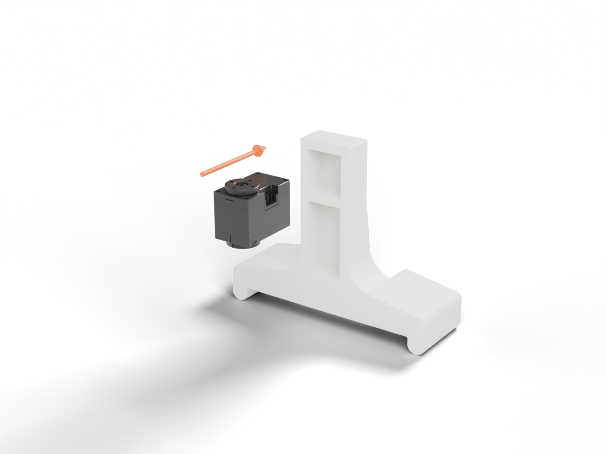
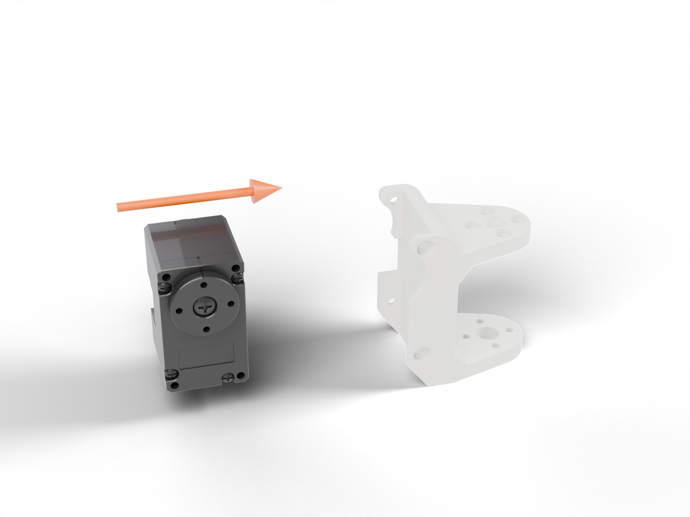
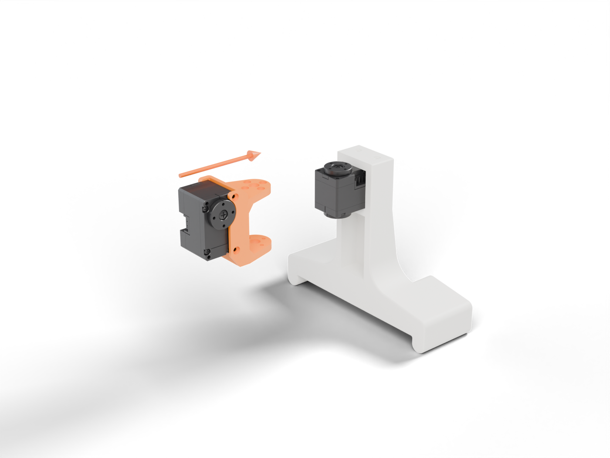
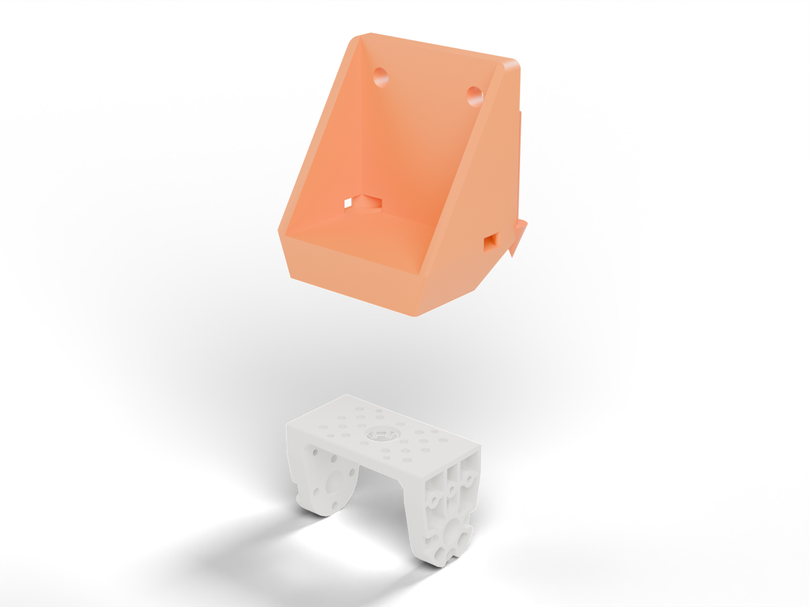
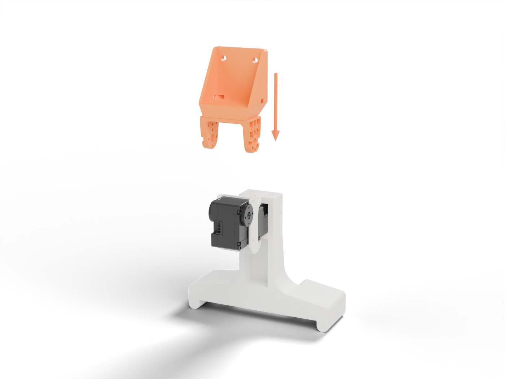
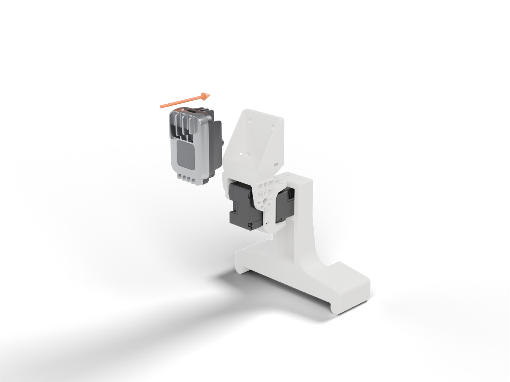
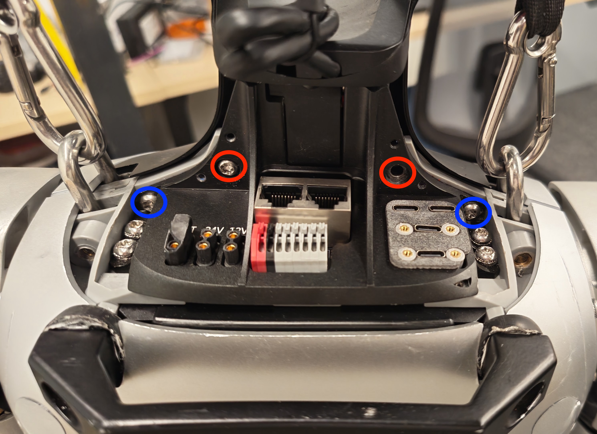

# Assembly

Also on the [project website](https://joga.csail.mit.edu/neck/). Parts are listed in [`BOM.md`](BOM.md).

## 1. Print

The [STLs](stl/) are already in print orientation. Start from the Bambu Studio **0.20mm Standard** profile and change:

| Setting | Value |
|---|---|
| Material | PETG (PLA also works) |
| Wall loops | 4 |
| Sparse infill | 25%, gyroid |
| Supports | Tree (auto) |

## 2. Build

The arrow shows how each new part goes in. New printed parts are orange.

**1. Yaw servo into the Torso Mount.** Slide the servo in from the front, output axis vertical, and fix it with 2× M2 from the back.

<p align="center"></p>

**2. Pitch servo into the Yaw-Pitch Bracket.** Slide the second servo into the bracket, output axis sideways, and fix it with 2× M2.

<p align="center"></p>

**3. Bracket onto the yaw servo.** Slide the bracket onto the yaw servo so its arms straddle both horns, then screw it to both horns.

<p align="center"></p>

**4. Camera Mount onto the Output Bracket.** Screw the Camera Mount to the top of the Output Bracket with M2 self-tapping screws from below.

<p align="center"></p>

**5. Output Bracket onto the pitch servo.** Lower it onto the pitch servo so the arms straddle both horns, then screw it to both horns.

<p align="center"></p>

**6. Camera onto the Camera Mount.** Seat the OAK-1 W lens forward and fix it with 2× M4 × 10 mm from the back.

<p align="center"></p>

## 3. Mount on the G1

<p align="center"></p>

1. Power the robot off and remove the two **red** and two **blue** screws.
2. Lift off the front neck cover and disconnect its microphone cable. The cover and red screws stay off.
3. Fasten the Torso Mount with the two **blue** screws through the holes in its back.

## 4. Wire

```
G1 12 V (XT30) → DROK converter → 5 V → U2D2 Power Hub → yaw servo → pitch servo
U2D2 → USB → your computer
OAK-1 W → USB-C → your computer
```

Use 16–18 AWG silicone wire for the power runs, and leave enough cable slack for the full range of motion.

Use a locking USB-C cable for the camera. A plain plug will eventually break the OAK-1 W's USB port. In a pinch, zip tie the cable through the strain relief holes in the Camera Mount.
