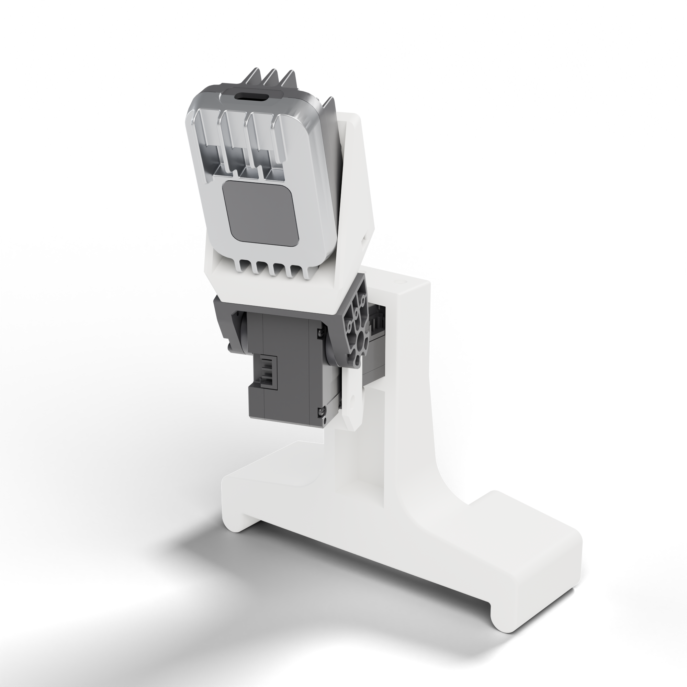
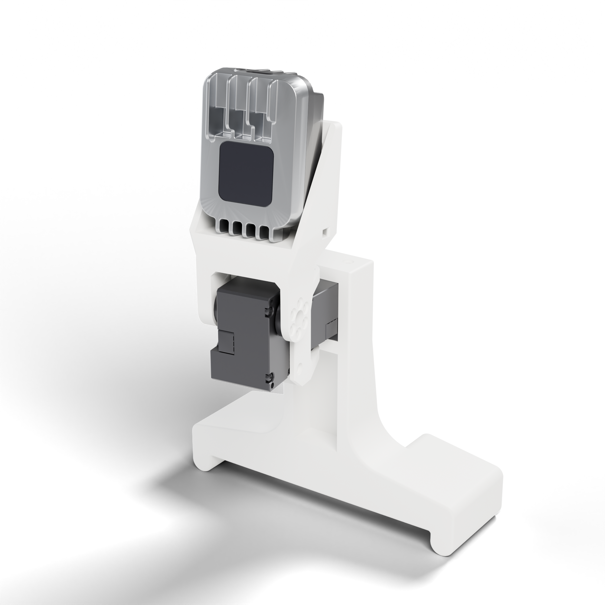

# Joga Neck

<p align="center">
  
  
</p>

An open-source 2-DoF camera neck for the Unitree G1, from [*Joga*: Learning Agile Humanoid Soccer Skills with Active Vision](https://joga.csail.mit.edu/). Two servos drive the camera directly, with no linkages, gears, or bearings, which keeps the neck fast and simple to model.

The neck comes in two versions. The DYNAMIXEL version (left) is the one we used in the paper. The Unitree version (right) uses Unitree J288 servos, which run directly on the G1's 24 V. Both share the Torso Mount, camera, and kinematics.

**Build guide: [joga.csail.mit.edu/neck](https://joga.csail.mit.edu/neck/)** (DYNAMIXEL version)

| | DYNAMIXEL | Unitree |
|---|---|---|
| Range of motion | Yaw ±90°, pitch 20° up / 90° down | Same |
| Actuators | 2× DYNAMIXEL XC330-M288-T | 2× Unitree J288 |
| Camera | Luxonis OAK-1 W | Same |
| Mass | ≈178 g | ≈200 g |
| Power | G1 12 V port, stepped down to 5 V | G1 24 V port |

## Contents

| Path | Contents |
|---|---|
| [`dynamixel/`](dynamixel/) | [Parts list](dynamixel/BOM.md), [assembly](dynamixel/ASSEMBLY.md), STLs, STEP ([Onshape](https://cad.onshape.com/documents/e0ac8b9ce8b5146068ab660f/w/0ec3993b994011827e40bf45/e/5923e8f908275dc28e41f6fa)), and URDF |
| [`unitree/`](unitree/) | [Parts list](unitree/BOM.md), [assembly](unitree/ASSEMBLY.md), STLs, STEP ([Onshape](https://cad.onshape.com/documents/382fbe71eeffda2dd390e792/w/ba12491f5e9494888e85d34c/e/9e58da07c4055d37c85d1a8b)), and URDF |

The 12 V [DYNAMIXEL XC330-T288-T](https://emanual.robotis.com/docs/en/dxl/x/xc330-t288/) also fits the DYNAMIXEL parts and removes the need for the converter.

## Citation

```bibtex
@misc{joga2026,
  title        = {Joga: Learning Agile Humanoid Soccer Skills with Active Vision},
  author       = {Narula, Avinash and Nguyen, Khai and Fey, Nolan and Parsuram, Venki and Marangola, John and Peticco, Martin and Agrawal, Pulkit},
  year         = {2026},
  howpublished = {\url{https://joga.csail.mit.edu/}}
}
```

## License

[CC BY 4.0](LICENSE). The DYNAMIXEL, Unitree, OAK-1, and Unitree G1 models come from their manufacturers and remain subject to their terms.
