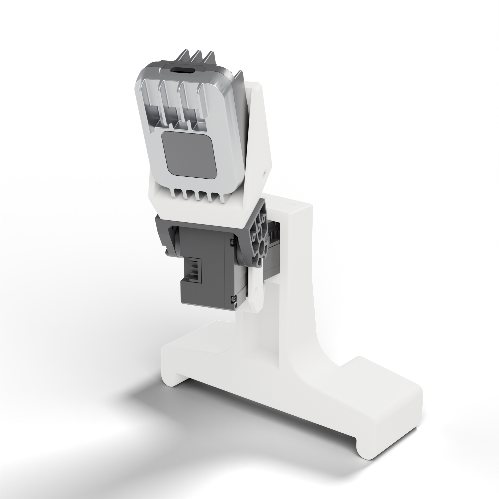
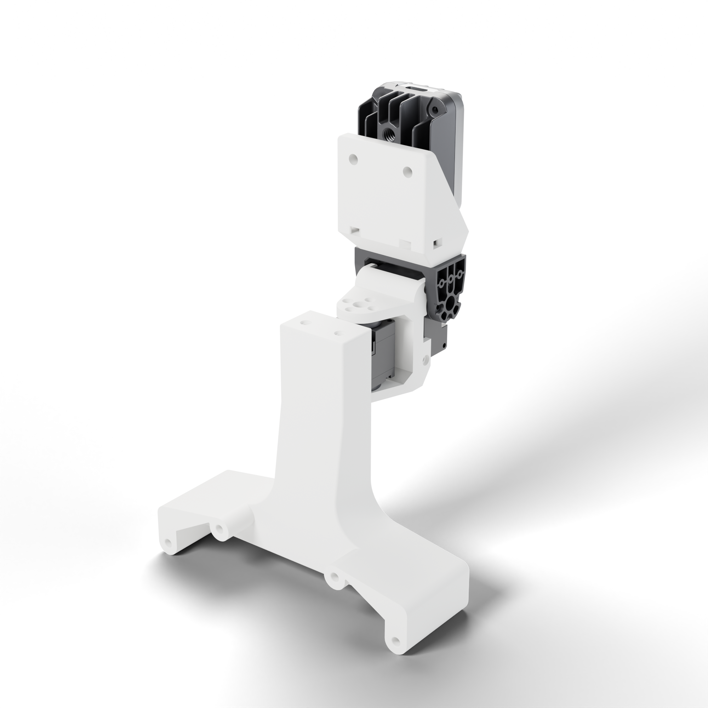

# Joga Neck

<p align="center">
  
  
</p>

An open-source 2-DoF camera neck for the Unitree G1, from [*Joga*: Learning Agile Humanoid Soccer Skills with Active Vision](https://joga.csail.mit.edu/). Two DYNAMIXEL servos drive the camera directly, with no linkages, gears, or bearings, which keeps the neck fast and simple to model.

**Build guide: [joga.csail.mit.edu/neck](https://joga.csail.mit.edu/neck/)**

| | |
|---|---|
| Range of motion | Yaw ±90°, pitch 20° up / 90° down |
| Actuators | 2× DYNAMIXEL XC330-M288-T |
| Camera | Luxonis OAK-1 W |
| Mass | ≈178 g |
| Power | G1 12 V port, stepped down to 5 V |

## Contents

| Path | Contents |
|---|---|
| [`BOM.md`](BOM.md) | Parts list |
| [`ASSEMBLY.md`](ASSEMBLY.md) | Printing, assembly, mounting, and wiring |
| [`stl/`](stl/) | Printed parts, in print orientation |
| [`cad/`](cad/) | STEP of the assembly ([Onshape](https://cad.onshape.com/documents/e0ac8b9ce8b5146068ab660f/w/0ec3993b994011827e40bf45/e/5923e8f908275dc28e41f6fa)) |
| [`urdf/`](urdf/) | Neck URDF and a MuJoCo model of the G1 with the neck |

The 12 V [DYNAMIXEL XC330-T288-T](https://emanual.robotis.com/docs/en/dxl/x/xc330-t288/) fits the same printed parts and removes the need for the converter. The [Unitree Brushless Digital Servo](https://shop.unitree.com/products/brushless-digital-servo?variant=50927641919721) is another option without the converter, but the printed parts need modifications for it.

## Citation

```bibtex
@misc{joga2026,
  title        = {Joga: Learning Agile Humanoid Soccer Skills with Active Vision},
  author       = {Narula, Avinash and Nguyen, Khai and Fey, Nolan and Parsuram, Venki and Marangola, John and Peticco, Martin and Agrawal, Pulkit},
  year         = {2026},
  howpublished = {\url{https://joga.csail.mit.edu/}}
}
```

## License

[CC BY 4.0](LICENSE). The DYNAMIXEL, OAK-1, and Unitree G1 models come from their manufacturers and remain subject to their terms.
