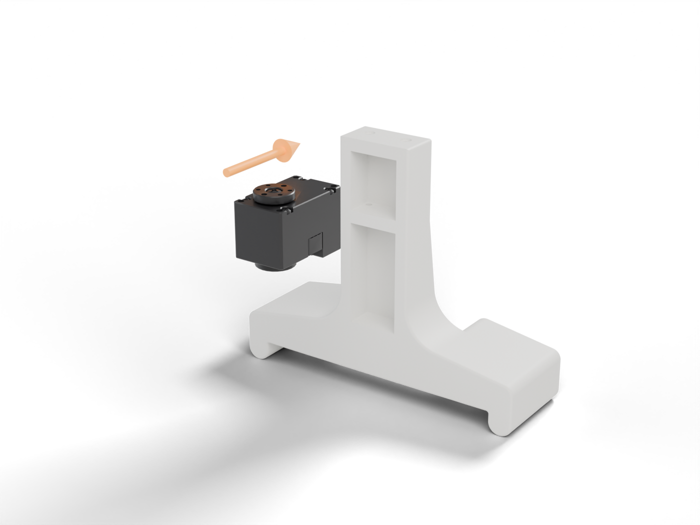
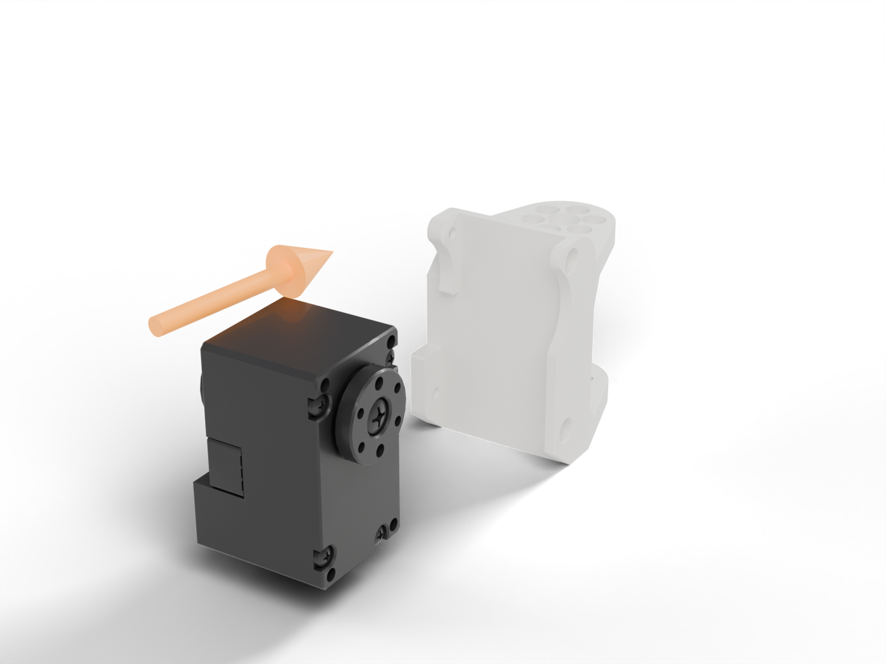
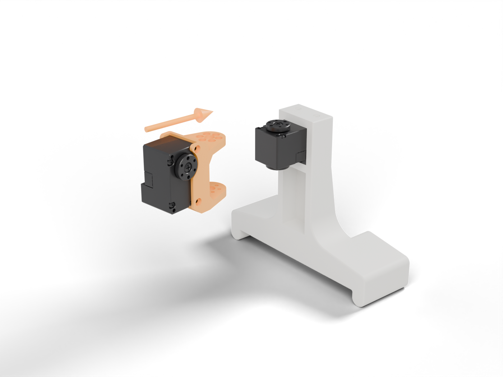
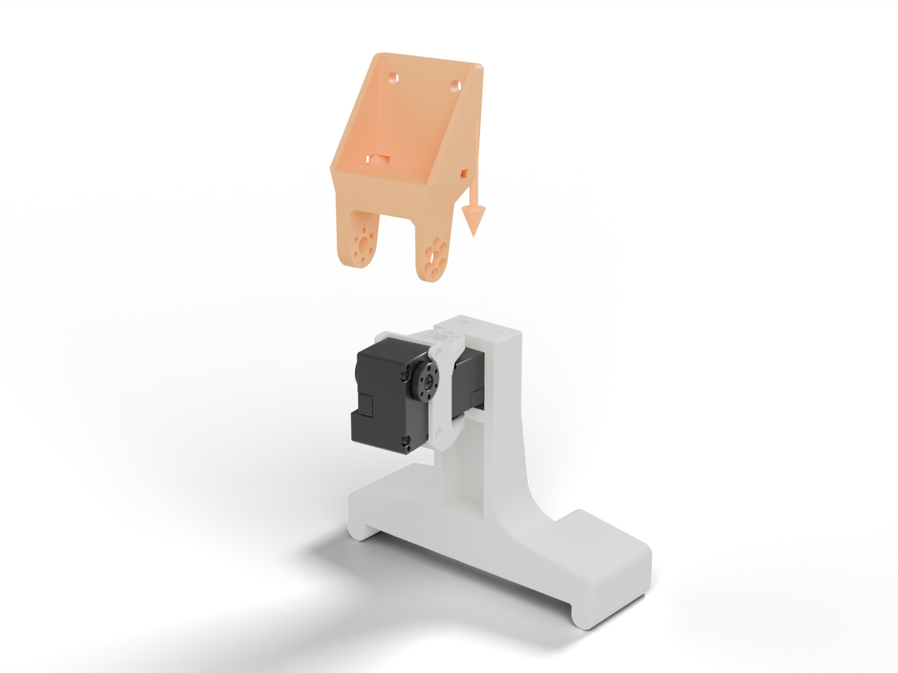
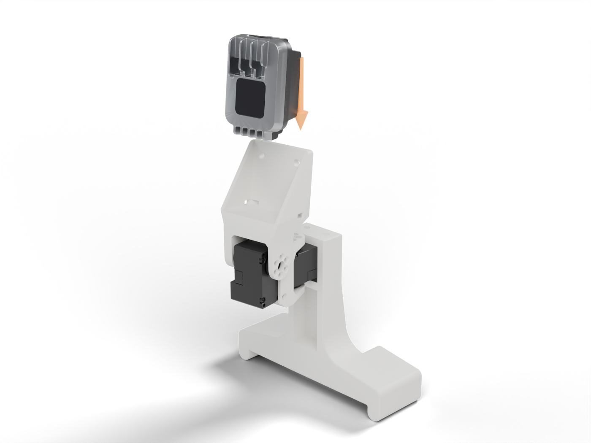
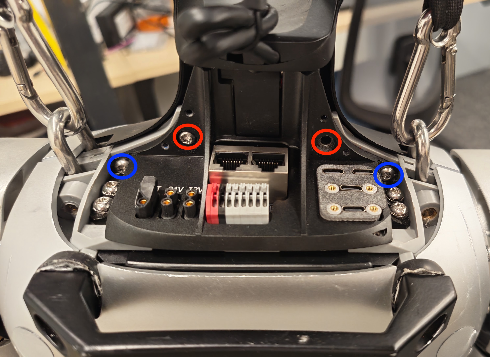

# Assembly (Unitree)

Parts are listed in [`BOM.md`](BOM.md).

## 1. Print

The [STLs](stl/) are already in print orientation. Start from the Bambu Studio **0.20mm Standard** profile and change:

| Setting | Value |
|---|---|
| Material | PETG (PLA also works) |
| Wall loops | 4 |
| Sparse infill | 25%, gyroid |
| Supports | Tree (auto) |

## 2. Build

The arrow shows how each new part goes in. New printed parts are orange. Use the screws included with the servos.

**1. Yaw servo into the Torso Mount.** Slide the servo in from the front, output facing up.

<p align="center"></p>

**2. Pitch servo into the Yaw-Pitch Bracket.** Slide the second servo in from the front, output facing sideways.

<p align="center"></p>

**3. Bracket onto the yaw servo.** Slide the bracket onto the yaw servo from the front and screw it to the horn.

<p align="center"></p>

**4. Camera Mount onto the pitch servo.** Lower the Camera Mount onto the pitch servo and screw it to the horn.

<p align="center"></p>

**5. Camera into the Camera Mount.** Lower the OAK-1 W in, lens forward, and fix it with 2× M4 × 10 mm from the back.

<p align="center"></p>

## 3. Mount on the G1

The Torso Mount attaches to the G1 the same way as in the DYNAMIXEL version.

<p align="center"></p>

1. Power the robot off and remove the two **red** and two **blue** screws.
2. Lift off the front neck cover and disconnect its microphone cable. The cover and red screws stay off.
3. Fasten the Torso Mount with the two **blue** screws through the holes in its back.

## 4. Wire

```
G1 24 V port → yaw servo → pitch servo
Serial-to-USB module → USB → your computer
OAK-1 W → USB-C → your computer
```

With the S288, use the G1's 12 V port instead, since the S288 only takes up to 12 V.

Use 16–18 AWG silicone wire for the power runs, and leave enough cable slack for the full range of motion.

Use a locking USB-C cable for the camera. A plain plug will eventually break the OAK-1 W's USB port. In a pinch, zip tie the cable through the strain relief holes in the Camera Mount.
